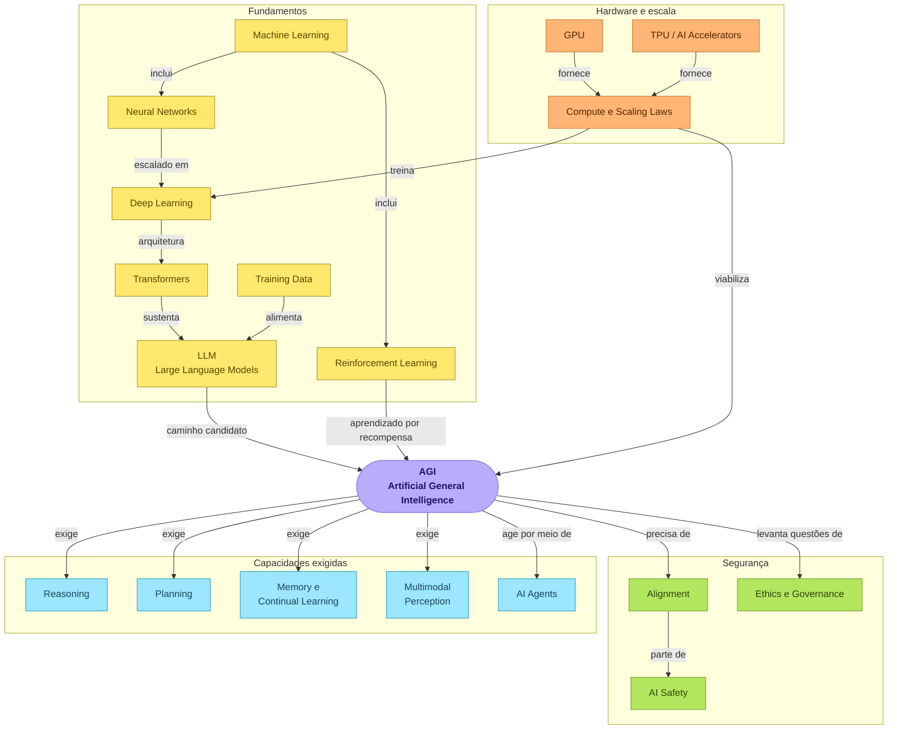
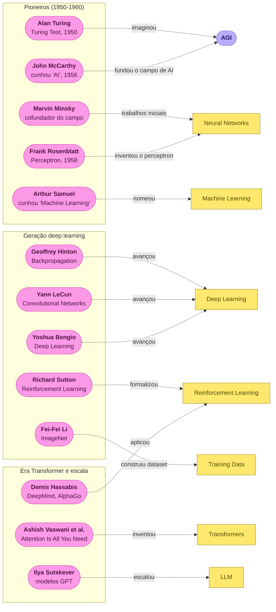
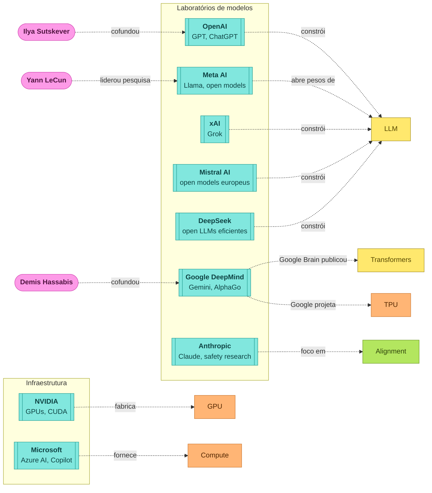
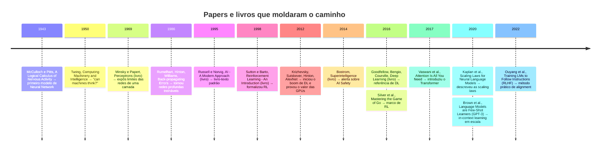

# Mapa visual: o caminho até AGI

> Diagramas em Mermaid. No VS Code, abra o preview com `Ctrl+Shift+V` (ou `Ctrl+K V` para lado a lado).
> Os quatro diagramas usam as mesmas cores: conceitos de base em amarelo, hardware em laranja, capacidades em azul, segurança em verde, pessoas em rosa, empresas em verde-água, papers e livros em marrom.

## 1. Mapa conceitual

## 2. Pessoas e o que cada uma moveu

## 3. Empresas

## 4. Linha do tempo de papers e livros

